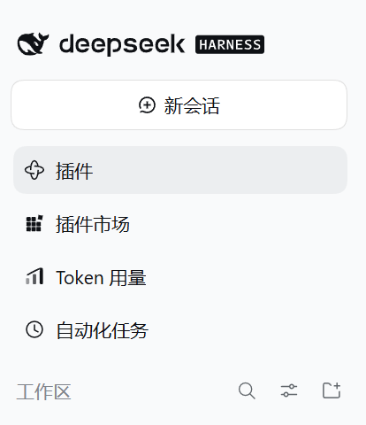
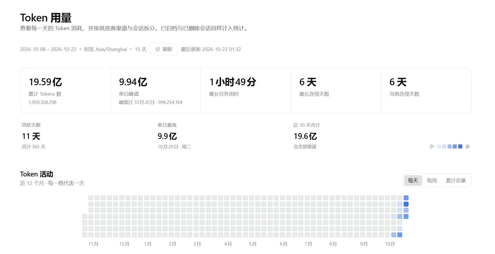
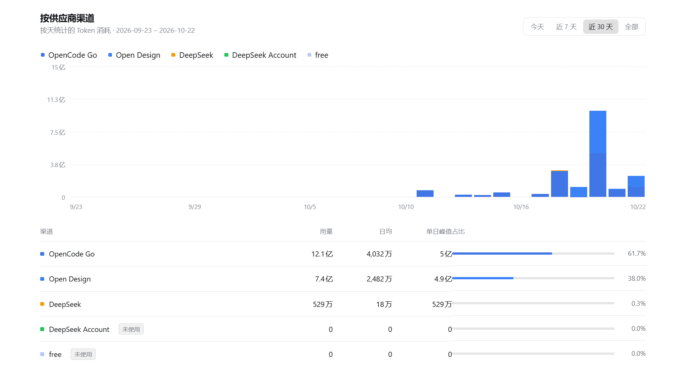
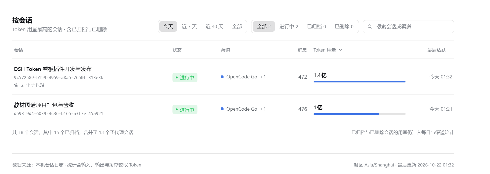

# Token 用量 · DeepSeek Harness 插件

在 DeepSeek Harness 左侧栏加一行 **Token 用量**，点开是一块看板：每天的 Token 消耗、各个供应商渠道的分摊、以及每个会话用了多少。

数据全部来自本机 Harness 自己的会话日志，**不联网、不上报、不需要填任何 API Key**。

## 安装

安装后，左侧栏会在「插件市场」和「自动化任务」之间多出一行 **Token 用量**：



### 方式一：插件市场（推荐）

打开 DSH → **插件** → 搜索 `dsh-token-dashboard` → 安装。

### 方式二：从本地目录安装

已经 clone 了仓库的话：

1. 打开 DSH → **插件** → **安装**
2. 选「本地目录」，填仓库所在目录（例如 `E:\dsh-plugin\dsh-tokenDashboard`）
3. 安装完成后，侧栏出现「Token 用量」

> 新装的插件如果侧栏没立刻出现，重启一次 DeepSeek Harness 即可——这是 DSH 对新装宿主插件的既有行为，不是插件本身的问题。

### 方式三：npm

```bash
dsh plugin add @zhujiuyi/dsh-token-dashboard
```

## 看板长什么样

顶部是累计用量概览，下面依次是每日热力图、按供应商渠道、按会话：



**按供应商渠道** —— 周期可选「今天 / 近 7 天 / 近 30 天 / 全部」；图例能点掉单个渠道，柱子会重新堆叠；
表格给出每个渠道的用量、日均、单日峰值和占比，配置了但没用过的渠道标「未使用」。



**按会话** —— 每个会话的消耗排行，可按「Token 用量」或「最后活跃」排序，支持状态筛选和搜索；
子代理会话的消耗已并入父会话（行内标注「含 N 个子代理」）。



---

## 它统计什么

- **按天**：每个自然日 00:00–24:00 的 Token 消耗；近 12 个月热力图，可切换「每天 / 每周 / 累计总量」三种着色方式。
- **按供应商渠道**：当前 profile 配置的供应商，加上日志里出现过的渠道（渠道后来被删掉，历史也照样保留）。
  周期可选 **今天 / 近 7 天 / 近 30 天 / 全部**；选「今天」时按 24 小时展开，能看到一天里哪几个小时在烧 Token。
- **按会话**：每个会话的消耗排行，**包含已归档的会话**，也包括日志里还在、但侧栏里已经被删掉的会话。
  子代理（subagent）的消耗并入它的父会话，不单独占一行。
- **概览**：累计 Tokens、单日峰值、最长任务用时、最长连续天数、当前连续天数。

## 用法

- 顶部「刷新」会丢弃缓存、重新读一遍日志；平时页面每 60 秒自动刷新一次（页面在后台时不刷新，切回来再刷）。
- 供应商图例可以点：点掉某个渠道，柱子会重新堆叠；再点一次恢复。
- 会话列表可按「Token 用量」或「最后活跃」排序，支持按状态筛选和按标题 / 会话 id / 渠道名搜索。
- 亮色、暗色主题都跟随 DSH 自身设置，不需要单独配置。

## 数字是怎么算出来的

| 项目 | 口径 |
|---|---|
| 用量 | 会话日志里每条模型回复的 `输入（未命中缓存）+ 输出 + 缓存读取 + 缓存写入` |
| 归属到哪个渠道 | 按日志顺序取当时生效的路由；一个会话中途换过供应商，会按实际发生的顺序分别计入 |
| 一天 | 本机时区的自然日 00:00–24:00 |
| 时间范围 | 统计全部历史；页面上的「今天 / 近 7 天 / 近 30 天 / 全部」只是视图筛选，不改变底层数据 |
| 子代理 | 按父会话关系合并，父会话日志缺失时子代理自己成行并标记 |
| 状态 | 进行中 / 已归档 / 已删除（日志还在、但会话已从列表里删掉） |

## 常见问题

**和供应商后台的账单对不上？**
这里统计的是 Harness 记录的 Token 数量，不是金额；而且账单通常按供应商自己的计费规则（缓存命中折扣、阶梯价）折算，两者本来就不会完全相等。这个看板回答的是「我在哪里、什么时候花了多少 Token」。

**为什么会有「已删除」的会话？**
会话从侧栏删掉后，日志文件仍在磁盘上。为了不丢历史用量，看板仍然会统计它，并标成「已删除」。你在会话列表里能一眼看出来它不是活跃会话。

**为什么「当前连续天数」在半夜没归零？**
如果今天还没开始用，连续天数会以昨天为锚继续算，不会在 00:00 闪成 0，等你今天第一次对话后自然延续。

**会不会上传我的数据？**
不会。插件只读本机 Harness 目录下的会话日志和会话列表，不发起任何网络请求，也不写任何 Harness 数据。

**支持哪些版本？**
需要带 `sidebar.panellist` 插槽的 DSH（即左侧栏有「插件」「插件市场」的那一版）。Node.js ≥ 20。

## 开发

仓库无依赖、无构建步骤：`index.js` 是宿主侧（读日志、聚合、提供 `/api/token-dashboard/snapshot`），`client/client.js` 是浏览器侧单文件页面。

```bash
npm test          # 宿主侧 56 项单元测试：日志解码、聚合口径、缓存与路由响应
npm run test:client  # 浏览器侧 30 项桩测：加载器契约、插槽注册、渲染与交互分支
npm run check     # 语法检查
```

目录结构：

```
index.js              宿主入口：注册数据接口
src/host/             日志解析、聚合、快照服务（纯 Node 内置模块）
client/client.js      浏览器页：侧栏入口 + 看板 UI
cordis.patch.yml      插件行声明
locale/               插件卡片标题与描述
docs/images/          截图
```

## 许可

MIT
